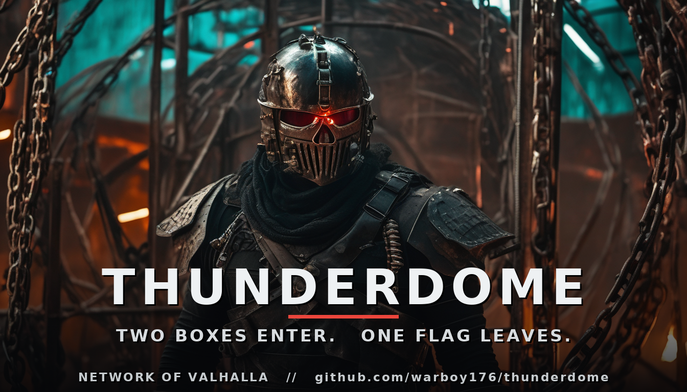

# THUNDERDOME — a self-hosted, graded pentest range

*Two boxes enter. One flag leaves.*

THUNDERDOME is a small, **always-solvable, fully isolated** practice range for the
offensive security **kill chain** — recon → enumerate → exploit → privesc → loot.
Every box has a capturable flag, so you get a clean, honest signal of progress:
flags captured = skill gained. Spin it up with one command, attack it from your
own machine, and grade yourself. Built by **Warboy (Network of Valhalla)**.

This is the **free base range**. A paid **Advanced Pack** (Active Directory attack
path, chained privilege escalation, custom-exploit boxes) lives on the
[Warboy Patreon](https://www.patreon.com/warboy176).

---

## ⚠️ Authorized use only

These boxes are **deliberately vulnerable**. They exist to be attacked **by you,
on your own machine, for learning**. The compose file binds everything to
`127.0.0.1` for that reason — **keep it that way and never expose these services
to a real network.** You are responsible for using the skills you build here only
against systems you own or are explicitly authorized to test. Warboy is not
responsible for any other use.

---

## Quick start

```bash
git clone https://github.com/warboy176/thunderdome
cd thunderdome
docker compose up -d --build        # stands up the range (localhost only)
```

That's it — the range is live on your loopback:

| Box | Service | Where |
| --- | --- | --- |
| `td-web`     | vulnerable web app | http://127.0.0.1:8080 |
| `td-service` | unauthenticated Redis | `127.0.0.1:6379` |

Tear it down with `docker compose down`.

---

## The range

Three flags, format `THD{...}`. Work the kill chain — don't read the source to
cheat yourself (the flags are hidden anyway). Hints, not solutions:

1. **Foothold — `td-web` (web → user flag).**
   The "NetTools" page runs a connectivity check on a host *you* supply. The input
   goes somewhere it shouldn't. Get a shell as the `td` user and read their flag.

2. **Root — `td-web` (privilege escalation → root flag).**
   Once you're `td`, look at what you're allowed to run as root
   (`sudo -l` is your friend). One of those binaries can do more than its job.
   GTFOBins exists for a reason. Read `/root/root.txt`.

3. **Service — `td-service` (unauthenticated Redis → flag).**
   The Redis instance never asked for a password. Connect and look around
   (`redis-cli -h 127.0.0.1`). On a real target this same mistake becomes RCE —
   this box just hands you the flag so you learn the enumeration.

### Grade yourself

```bash
python3 grade.py THD{your_captured_flag}      # submit as you go
python3 grade.py                               # show progress
```

`3/3` and the range is cleared.

---

## What this is (and isn't)

- **Is:** a tiny, honest, reproducible range to drill the kill chain end to end —
  the kind of always-solvable target that gives a real growth signal (unlike a
  fixed CTF you solve once).
- **Isn't:** a sprawling 50-box platform. It's deliberately small and clean. The
  **Advanced Pack** on Patreon is where the depth lives — a full **Active
  Directory** attack path (AS-REP roasting, Kerberoasting, DCSync), chained
  multi-host privilege escalation, and boxes with no off-the-shelf exploit that
  push you to build your own.

---

## Advanced Pack (Patreon)

The premium tier adds:
- **AD kill-chain lab** — a Samba-backed domain: enumerate → AS-REP → Kerberoast → DCSync → domain admin.
- **Chained privesc** — multi-stage boxes where root on one is only the pivot to the next.
- **Custom-exploit boxes** — vulnerable services with no public exploit; you write the PoC.
- Full walkthroughs + a grading rubric for the whole chain.

→ **[patreon.com/warboy176](https://www.patreon.com/warboy176)**

---

## License

MIT — see [LICENSE](LICENSE). Use it, fork it, build your own boxes on top of it.
